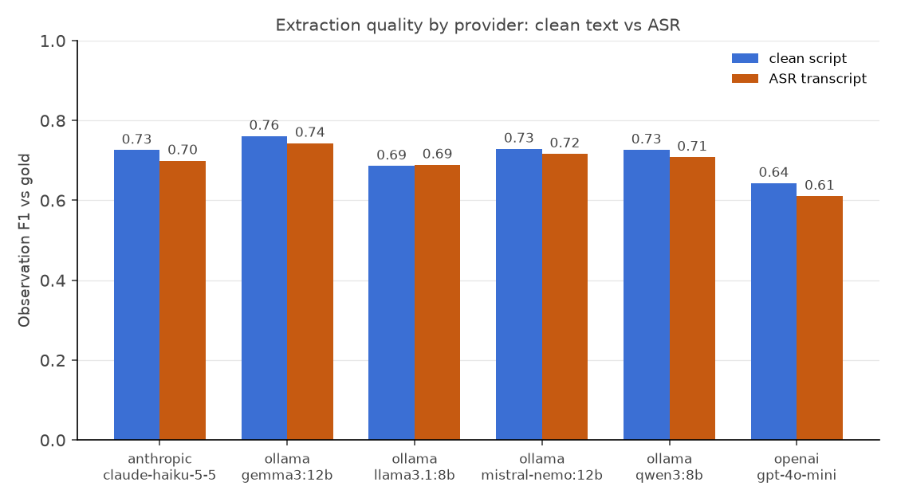

# Eval results

100 notes x 6 model columns x 2 conditions (clean script vs ASR transcript). Repair-retry enabled, cross-provider fallback disabled for fair per-model columns.

## Quality

| Provider | Model | Condition | Obs P | Obs R | Obs F1 | Themenfeld acc | Risk P | Risk R | Resident acc | Unsupported claims |
|---|---|---|---|---|---|---|---|---|---|---|
| anthropic | claude-haiku-5-5 | asr | 0.77 | 0.68 | **0.70** | 0.88 | 0.95 | 0.98 | 0.74 | 1.0% |
| anthropic | claude-haiku-5-5 | clean | 0.81 | 0.69 | **0.73** | 0.85 | 0.95 | 0.96 | 0.91 | 0.0% |
| ollama | gemma3:12b | asr | 0.68 | 0.90 | **0.74** | 0.71 | 0.86 | 0.92 | 0.77 | 5.0% |
| ollama | gemma3:12b | clean | 0.71 | 0.90 | **0.76** | 0.70 | 0.88 | 0.93 | 0.98 | 6.0% |
| ollama | llama3.1:8b | asr | 0.68 | 0.80 | **0.69** | 0.52 | 0.73 | 0.84 | 0.76 | 6.0% |
| ollama | llama3.1:8b | clean | 0.68 | 0.80 | **0.69** | 0.51 | 0.72 | 0.85 | 0.98 | 4.3% |
| ollama | mistral-nemo:12b | asr | 0.77 | 0.75 | **0.72** | 0.64 | 0.79 | 0.89 | 0.36 | 13.4% |
| ollama | mistral-nemo:12b | clean | 0.79 | 0.76 | **0.73** | 0.62 | 0.78 | 0.86 | 0.40 | 13.6% |
| ollama | qwen3:8b | asr | 0.83 | 0.67 | **0.71** | 0.54 | 0.79 | 0.93 | 0.76 | 2.4% |
| ollama | qwen3:8b | clean | 0.85 | 0.69 | **0.73** | 0.62 | 0.82 | 0.94 | 0.98 | 1.5% |
| openai | gpt-4o-mini | asr | 0.78 | 0.55 | **0.61** | 0.78 | 0.84 | 0.89 | 0.77 | 20.9% |
| openai | gpt-4o-mini | clean | 0.82 | 0.58 | **0.64** | 0.73 | 0.83 | 0.88 | 0.98 | 21.7% |

## Latency, reliability, cost

| Provider | Model | Condition | p50 latency | p95 latency | Retry rate | Human review | $/note | $/1k notes | €/1k notes |
|---|---|---|---|---|---|---|---|---|---|
| anthropic | claude-haiku-5-5 | asr | 5.4s | 7.9s | 0% | 0% | $0.00104 | $1.04 | €0.96 |
| anthropic | claude-haiku-5-5 | clean | 5.2s | 8.3s | 0% | 0% | $0.00101 | $1.01 | €0.93 |
| ollama | gemma3:12b | asr | 8.4s | 12.9s | 0% | 0% | $0.00000 | $0.00 | €0.00 |
| ollama | gemma3:12b | clean | 8.8s | 12.7s | 0% | 0% | $0.00000 | $0.00 | €0.00 |
| ollama | llama3.1:8b | asr | 5.2s | 8.0s | 0% | 0% | $0.00000 | $0.00 | €0.00 |
| ollama | llama3.1:8b | clean | 5.1s | 7.9s | 0% | 0% | $0.00000 | $0.00 | €0.00 |
| ollama | mistral-nemo:12b | asr | 5.3s | 8.5s | 0% | 0% | $0.00000 | $0.00 | €0.00 |
| ollama | mistral-nemo:12b | clean | 5.1s | 8.8s | 0% | 0% | $0.00000 | $0.00 | €0.00 |
| ollama | qwen3:8b | asr | 4.9s | 7.3s | 0% | 0% | $0.00000 | $0.00 | €0.00 |
| ollama | qwen3:8b | clean | 4.9s | 7.5s | 0% | 0% | $0.00000 | $0.00 | €0.00 |
| openai | gpt-4o-mini | asr | 2.8s | 4.7s | 2% | 1% | $0.00037 | $0.37 | €0.34 |
| openai | gpt-4o-mini | clean | 2.9s | 5.3s | 3% | 1% | $0.00038 | $0.38 | €0.35 |

## ASR quality (faster-whisper)

Mean WER across 100 notes: **8.8%** (worst: note_53 at 54.5%). Local models run at zero marginal cost; $/note covers API providers only.

